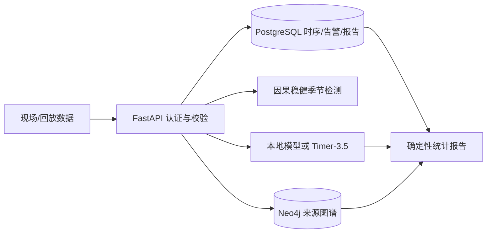

# 架构与选型记录（2026-10-16）

## 范围和数据流

业务状态：新点写入后为 `normal`、`insufficient_history`、`alert`、`suppressed_by_cooldown`、`suppressed_by_hysteresis` 或 `late_or_first`。报警从 `open` 到 `acknowledged`，重复确认幂等。相同资产/时间戳不允许不同值；资产行锁使并发逐点流入有序。`detector_state` 表每资产记录上次报警时间与布防状态，只有偏差回落到 3 以下才重新布防，状态更新为条件写。PostgreSQL 使用上限 16 个连接的 Psycopg 同步连接池。报告保存快照，来源事实始终单独列出。API 单宿主、单租户 API Key；无控制设备写回。

## 当前来源和决定

| 决定 | 一手资料 | 理由及边界 |
| --- | --- | --- |
| ATR 301 逐小时流量 | [UCI 原始条目](https://archive.ics.uci.edu/dataset/492/metro+interstate+traffic+volume) | 标明 Minnesota DoT 站点、2012–2018 年、CC BY 4.0；原始时间无时区偏移，演示统一按固定 UTC−06:00 解释。 |
| NAB realTraffic 异常回放 | [NAB 数据说明](https://github.com/numenta/NAB/blob/master/data/README.md)、[评分代码](https://github.com/numenta/NAB/blob/master/nab/sweeper.py) | 7 个真实交通序列、14 个标签窗；仅报告交通子集归一分数，不能与 58 序列排行榜直接比较。上游 MIT 许可文本存于 `third_party/NAB_LICENSE.txt`。 |
| 检测器知识图谱 | [FHWA 图 2‑1 与原理说明](https://www.fhwa.dot.gov/publications/research/operations/its/06108/02.cfm)、[Neo4j Docker](https://neo4j.com/docs/operations-manual/current/docker/) | 以图号与摘录保存通用回路、电缆、机柜、电子单元关系；不移植成 ATR 301 的现场接线。 |
| Timer‑3.5 外部预测 | [Timecho Python SDK 文档](https://ai.timecho.com/docs/zh-cn/sdk/python/) | Python SDK 当前安装版为 0.2.6；实际签名使用 `data`、`target`、`output_start_time`，与网页旧示例不同。只通过环境变量传密钥，显式远程模式失败返回 503。 |
| PostgreSQL + Neo4j | [PostgreSQL](https://www.postgresql.org/docs/current/)、[Neo4j 官方 Docker 文档](https://neo4j.com/docs/operations-manual/current/docker/) | 事务保证时序/报警/报告幂等与确认状态，图数据库存证据关系。MVP 不引入队列或流处理集群。 |

本地预测用仅包含过去 168 小时流量与日历特征的梯度提升模型；1–8 小时预测使用直接多步模型，更长范围使用单步模型递推。不输入未来天气或测试集流量。因果异常检测比较当前值与过去同日相位的稳健中位数/MAD，并采用 3 小时同资产冷却加回差重新布防（偏差不回落则持续抑制，回落即恢复布防）。报告的数值由已落库观测确定，图谱摘录不进入统计计算。

## 关键备选方案

| 议题 | 候选 | 实测/资料后的处理 |
| --- | --- | --- |
| 预测 | Timer‑3.5、直接多步梯度提升、递推梯度提升、昨天/上周同小时 | Timer 保留为可配置远程主路径，SDK 协议已模拟验收并完成真实密钥连通与 24 点抽查；本地直接模型在相同 2018 回测起点优于递推和季节基线，作为离线可运行路径。 |
| 报警 | 稳健季节偏差、局部变化联合过滤、NAB 过去窗口基线、[NAB 相对熵检测器](https://github.com/numenta/NAB/blob/master/nab/detectors/relative_entropy/relative_entropy_detector.py) | 3 小时冷却 + 回差重新布防在同批 14 个标签窗上把交通子集标准分从 76.2 提到 81.1，越过同子集 numentaTM 官方结果（79.0）。联合过滤减少窗外报警但标准分降低，已回退。上游相对熵基类初始化使用整文件最大/最小值，不能原样用于严格在线回放；暂不把它的历史结果当实时能力。 |
| 图谱 | Neo4j Community、关系表 | 选 Neo4j 满足构件/关系/来源的显式图查询；事务时序记录仍由 PostgreSQL 承担。 |

上述异常策略的比较使用了同一批 NAB 标签，属于探索性优化；没有未见过的确认集。不能仅凭当前交通子集评分对外宣称行业领先。

## 风险与扩展触发

- 实时性目前由同步 HTTP 和 PostgreSQL 单实例承载；大规模传感器或严格毫秒级 SLA 出现时需压测后增加消息队列、分区与异步计算。
- 告警主要是统计异常，不等于事故或设备故障诊断。需要现场维护记录、拓扑验证与人工确认才能做根因判断。
- 图纸事实录入有来源锚点，但 `site_supplied` 仅表示提交者提供，不代表系统已核验原图。实际工程应增加原件哈希、图纸版本、双人审核和撤销工作流。
- Timer‑3.5 是远程服务，容量、成本、可用性及数据外传策略需在目标环境单独验收；本地模型只对 ATR 301 数据域有量化效果证据。

